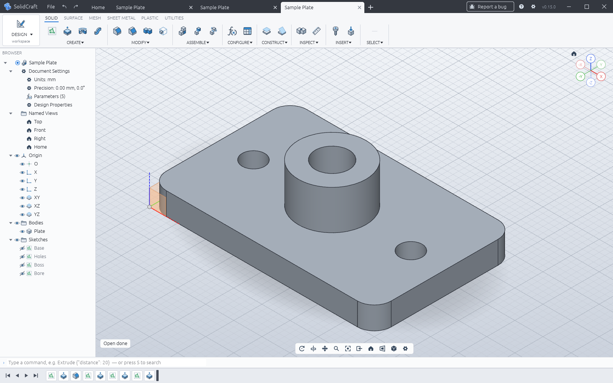

# Duplicate model tabs evidence

Before-fix reproduction for tangency-labs/solidcraft#2413, captured in SolidCraft 0.15.0 on Windows using the built-in Sample Plate. Saving once and opening the same file twice creates three tabs. Expected: retain one tab.

This evidence-only branch is independent of the implementation PR.
